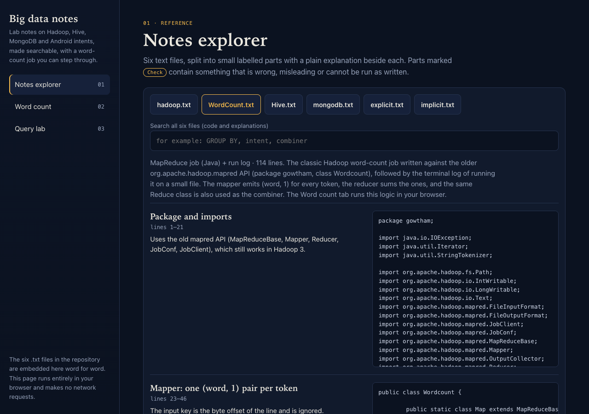
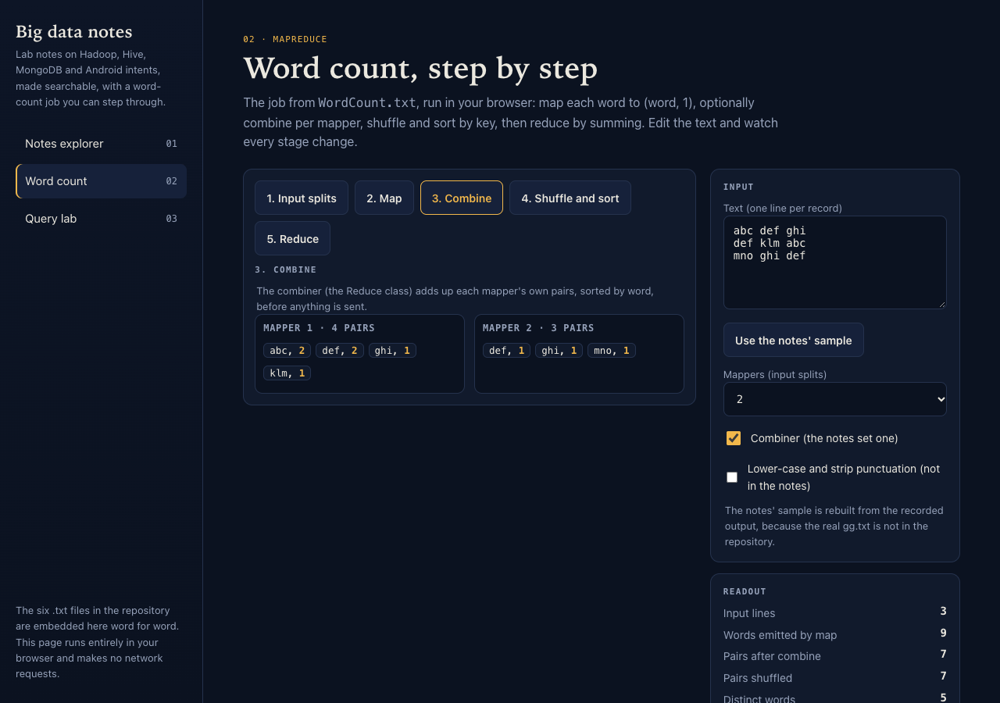
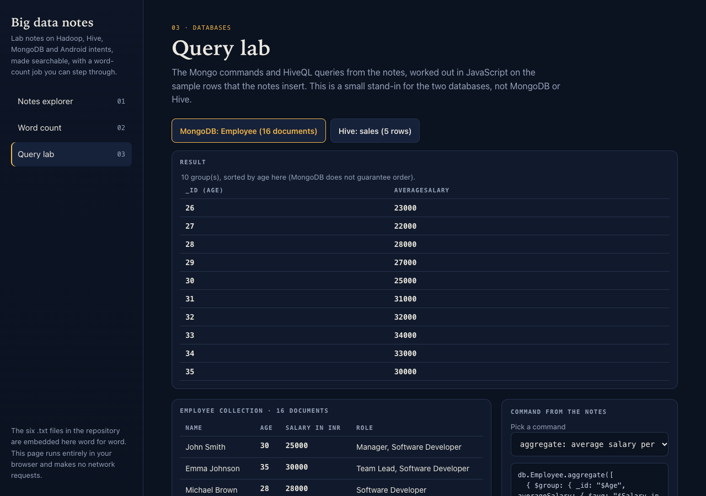

# Big: Hadoop, Hive, MongoDB and Android intent lab notes

Six plain-text lab notes from a big-data and mobile-apps course: an HDFS shell session, a Java MapReduce word-count job with its run log, HiveQL on a sales table, MongoDB shell commands on an employee collection, and two small Android apps that demonstrate intents. The files are notes, not a runnable project: there is no build, no dependencies, and no test data other than what is pasted inside the notes.

`docs/index.html` turns them into something you can read and try: a searchable notes explorer (every file split into labelled parts with a plain explanation), a step-by-step word-count visualiser, and a small query lab that works out the Mongo and Hive results on the notes' own sample data.







## Open the demo

Open `docs/index.html` in a browser. It is one self-contained file: no network requests, no libraries. (GitHub Pages is not enabled for this repository; if you turn it on, serve the `/docs` folder.)

## The files

| File | What it is | Lines | What is in it |
|---|---|---|---|
| `hadoop.txt` | HDFS shell session, Hadoop 3.2.4 on Ubuntu, 1 July 2023 | 169 | start-all.sh and jps, `-ls`, `-mkdir`, `-touchz`, `-copyFromLocal`, `-put`, `-cat`, `-copyToLocal`, `-moveFromLocal`, `-cp`, `-mv`, `-du`, `-dus`, `-stat`, `-appendToFile` |
| `WordCount.txt` | Java MapReduce job (package `gowtham`, class `Wordcount`, old `mapred` API) plus the terminal log of running it | 114 | mapper, reducer (also the combiner), driver, and the output `abc 2, def 3, ghi 2, klm 1, mno 1` |
| `Hive.txt` | HiveQL on a `sales` table | 85 | create table, load, five inserted rows, three GROUP BY queries, two views, two lookups |
| `mongodb.txt` | MongoDB shell commands on an `Employee` collection | 224 | find, count, deleteOne, updateMany, aggregate, map-reduce, a 16-document `insertMany`, and a second map-reduce on `Sta` |
| `explicit.txt` | Android dialer app | 66 | `Intent.ACTION_DIAL` with a `tel:` URI, layout XML |
| `implicit.txt` | Android two-screen app | 108 | `new Intent(MainActivity.this, MainActivity2.class)` with a Bundle extra, two layouts |

The demo splits these into 43 labelled parts. Every line of every file belongs to a part, and the part text is the file text word for word (checked by comparing each part with the matching line range of its file).

## The three demo tabs

| Tab | What it does | Data | Measured result |
|---|---|---|---|
| Notes explorer | Shows each file part by part with a plain explanation; searches code and explanations across all six files; 10 parts are marked **Check** | the six `.txt` files, embedded verbatim | 43 parts, all text matches the files |
| Word count | Runs the `WordCount.txt` job on text you type: map to (word, 1), optional combiner per mapper, shuffle and sort by UTF-8 bytes, reduce by summing. Choose 1 to 4 mappers. | a sample rebuilt from the recorded output (see below), or your own text | the sample gives `abc 2, def 3, ghi 2, klm 1, mno 1`, identical to the log in `WordCount.txt` |
| Query lab | Works out each Mongo and Hive command from the notes on their sample rows; accepts your own `find` filter | the 16 employees from `insertMany`; the 5 rows from the Hive `INSERT` | see the table below |

### Word count

`StringTokenizer` splits on space, tab, newline, carriage return and form feed, so punctuation stays attached to words and capitals are separate words. The page applies the same rules, adds an optional "lower-case and strip punctuation" box that is not in the notes, and shows the counts at every stage. With the combiner on, each mapper adds up its own words first: for the sample split over 2 mappers that is 9 words emitted, 7 pairs shuffled (9 shuffled with the combiner off); the final counts are identical.

The original `gg.txt` is not in the repository. The page's sample (`abc def ghi / def klm abc / mno ghi def`) is my reconstruction: it is one input that produces the recorded output, not the original file.

### Query lab results (computed on the sample rows)

| Command (from the notes) | Result |
|---|---|
| `find` middle name Kumar | 16 of 16 employees |
| `find` salary > 20000 and < 35000 | 16 of 16 |
| `countDocuments` Role Manager | 3 |
| `deleteOne` Rajesh / Scientist | 0 deleted (no such employee) |
| `find` age < 35, salary 30000 to 34999 | 6: Sophia Davis, Alexander Taylor, Ava Anderson, Mia Rodriguez, Benjamin Harris, Henry Lewis |
| `updateMany` Role Team Lead to 55650 | matched 2, modified 2 (Emma Johnson, Mia Rodriguez); running the `$in` version afterwards modifies 0 |
| `aggregate` average salary per age | 10 age groups, 26 to 35 (before the update) |
| `mapReduce` average salary per age | same 10 values as the aggregate (every age has at most two employees, so the reducer is called with at most two values) |
| `mapReduce` on `Sta` | cannot run: no `Sta` data in the notes |
| Hive `GROUP BY country` | Country1 2, Country2 2, Country3 1 |
| Hive `GROUP BY state` | State1 to State5, 1 each |
| Hive view `visa_transactions` / `mastercard_transactions` | ids 1, 3, 4 / ids 2, 5 |
| Hive `state = 'Seattle'` | 0 rows (states are State1 to State5) |

## How the demo was checked

- Word count: 14 inputs (the sample, 12 seeded random texts with mixed case, punctuation, tabs, blank lines and non-ASCII words, and one lower-casing case), each with a mapper count between 1 and 4 and the combiner on or off, in a real browser. The output text, the words emitted, the pairs shuffled, the distinct-word count and the line count all matched a separate Python implementation of the same rules (0 mismatches).
- Query lab: every Mongo and Hive preset was run through the page and compared with a Python computation made directly from `mongodb.txt` and `Hive.txt`; all matched. The custom filter box was checked against the same Python filter.
- Layout: viewed at 1280 px wide and 390 px wide, no horizontal overflow and no script errors.

## Honest notes

- **Nothing here was run on the real systems.** Hadoop, Hive, MongoDB and an Android toolchain are not installed on the machine used to build the demo, and Java is not available, so `Wordcount.java` was not compiled or run. The demo is a re-implementation of the same logic. The recorded output in `WordCount.txt` is the evidence that the original job worked.
- The query lab is a few hand-written JavaScript functions plus a small matcher, not MongoDB or Hive. It only knows the queries in the notes and the operators listed on the page.
- The two Android file names look swapped. `explicit.txt` builds `new Intent(Intent.ACTION_DIAL, uri)` with no class name: an **implicit** intent. `implicit.txt` builds `new Intent(MainActivity.this, MainActivity2.class)`: an **explicit** intent. I kept the file names as they are and noted it in the demo.
- Items marked Check in the explorer (found by reading the code, not by running it):
  - `hadoop.txt`: the first `-ls` after `-mkdir /prog2` says "Found 3 items" but lists two (a pasted line is missing).
  - `WordCount.txt`: `hadoop jar gow.jar /g1input /g1output` gives no main class, which only works if the jar manifest sets one; the output directory must not already exist.
  - `Hive.txt`: `GROUP_CONCAT` is MySQL, not HiveQL (Hive: `concat_ws(',', collect_list(name))`); the last query selects `state` next to `MAX()` without `GROUP BY`, which Hive rejects; the `LOAD DATA` path is a placeholder.
  - `mongodb.txt`: `Array.avg` and `Array.sum` are helpers from the old mongo shell; the average-of-averages reducer is only right when reduce runs once per key; map-reduce is deprecated since MongoDB 5.0; the final map-reduce targets a collection (`Sta`) and fields that are not in the data; the queries come before the `insertMany` that creates their data.
  - `explicit.txt`: the `uses-permission` tag is not closed, and `ACTION_DIAL` does not need `CALL_PHONE`.
  - `implicit.txt`: starts without a `package` line; the layouts are named `activity1.xml` / `activity2.xml` while the code loads `activity_main` / `activity_main2`.
- The six `.txt` files are unchanged. The demo is additive.

## Fixes made

None to the notes themselves: the repository has no scripts, and rewriting someone's lab notes would hide what they originally wrote. The findings above are written up in the demo instead.

## Repo layout

```
.
├── README.md
├── Hive.txt
├── WordCount.txt
├── explicit.txt
├── hadoop.txt
├── implicit.txt
├── mongodb.txt
└── docs/
    ├── index.html        notes explorer, word-count visualiser, query lab (single file)
    └── assets/           README screenshots
```

## Requirements

A modern browser to open `docs/index.html`. Running the original notes needs Hadoop 3.x with Java (word count and HDFS), Hive, MongoDB (legacy shell for `Array.avg`), and Android Studio for the two apps; none of those are needed for the demo.
